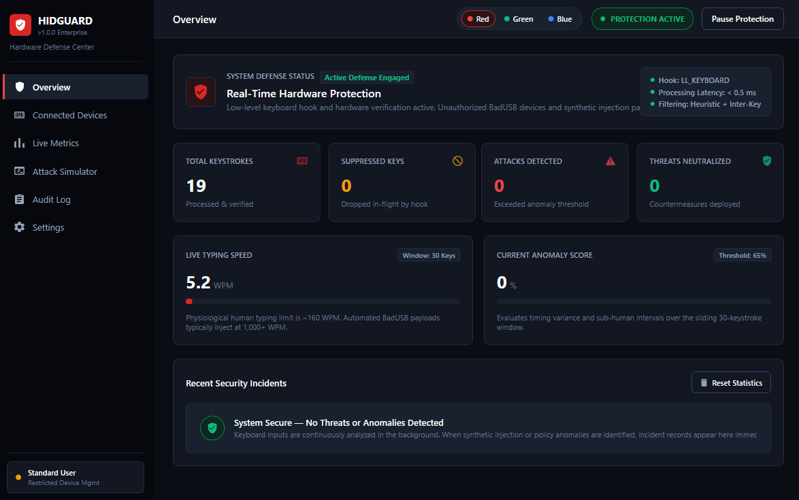
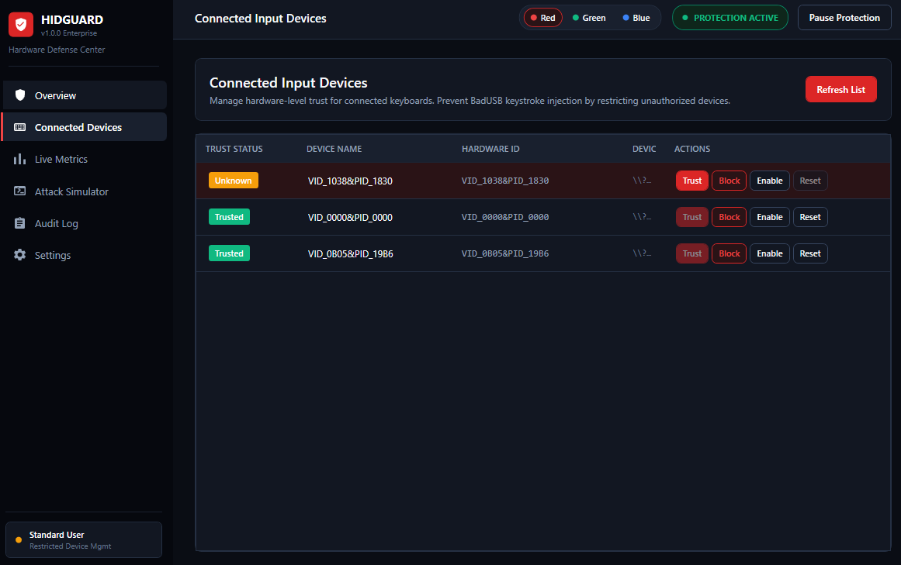
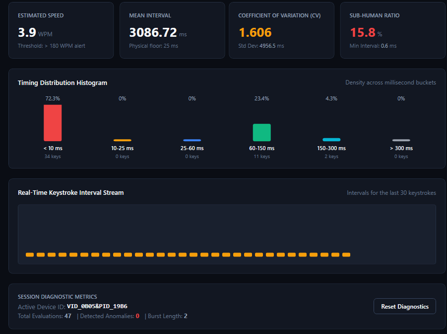
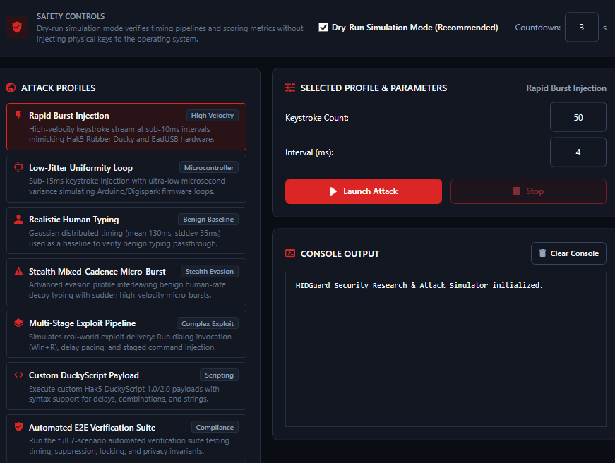
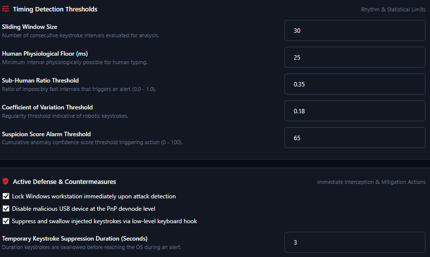
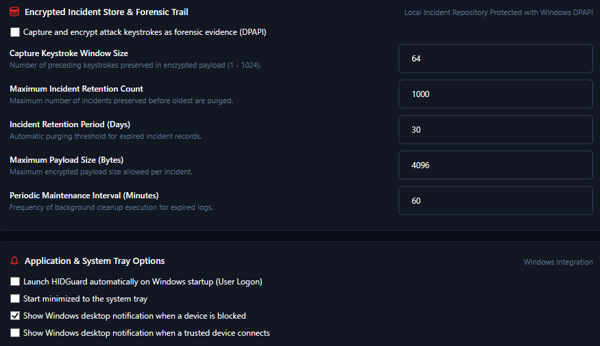

# HIDGuard

Hardware-Level Keyboard & BadUSB Mitigation System for Windows

[English](README.md) | [Türkçe](README.tr.md)

---

## What is HIDGuard?

HIDGuard is an open-source Windows endpoint defense system designed to block keystroke injection attacks delivered by microcontrollers such as the **Hak5 USB Rubber Ducky**, **Flipper Zero**, **Digispark**, **Teensy**, and **Raspberry Pi Pico**.

While traditional operating systems and antivirus software inherently trust newly connected USB keyboards, HIDGuard continuously analyzes the **biomechanical and temporal properties** of keystrokes (inter-keystroke intervals and variance) to instantly distinguish legitimate human typing from automated hardware payloads.

---

## Key Features

- **Real-Time Active Defense**: When synthetic injection is detected, malicious keystrokes are intercepted and swallowed in flight (`WH_KEYBOARD_LL`), the workstation is instantly locked (`LockWorkStation`), and the rogue device can be disabled at the Windows device tree level (`CM_Disable_DevNode`).
- **Zero-Keylogging Privacy Guarantee**: Keystroke characters, passwords, and alphanumeric inputs are never logged, stored, or transmitted during normal operation. Only non-sensitive hardware metadata and millisecond timing metrics are processed.
- **100% Offline & Private**: Zero external telemetry, tracking, or network connections.
- **3 Dark Cybersecurity Themes**: Live switching between Red-Black (Default - Crimson Obsidian), Green-Black (Terminal / Matrix), and Blue-Black (Cobalt Defense).
- **Integrated Attack Simulator**: Safe dry-run research studio for editing, testing, and verifying Rubber Ducky / DuckyScript payloads against defensive policies.

---

## Quick Start

### 1. Launch
Run the turnkey launcher script:

```cmd
.\run-hidguard.bat
```

or launch the published executable directly:

```cmd
.\publish\HidGuard.App.exe
```

### 2. Build from Source
Ensure [.NET 8 SDK](https://dotnet.microsoft.com/download/dotnet/8.0) is installed:

```cmd
dotnet run --project src/HidGuard.App/HidGuard.App.csproj -c Release
```

To compile a standalone Release binary into `publish\`:

```cmd
.\build-exe.bat
```

---

## Screenshots & Application Views

| Overview & Protection Dashboard | Connected Devices & Trust Management |
| :---: | :---: |
|  |  |
| **Real-time protection status, active defense metrics, and incident alerts.** | **Hardware identification, trust enforcement, and PnP device control.** |

| Live Biomechanical Metrics | Attack Simulator Studio |
| :---: | :---: |
|  |  |
| **Inter-keystroke timing charts, WPM estimation, and interval histogram.** | **Dry-run testing, DuckyScript studio, and automated verification suites.** |

| Timing Detection Thresholds | Encrypted Forensics & Tray Options |
| :---: | :---: |
|  |  |
| **Statistical thresholds, sliding window sizes, and active countermeasures.** | **DPAPI-protected incident vault, log retention, and startup preferences.** |

---

## Technical Documentation

For user walkthroughs, mathematical timing models, Win32 raw input internals, and threat analysis:
- [User Guide & Threat Overview](docs/USER_GUIDE.md)
- [Deep Dive Architecture & Technical Specification](docs/architecture-and-deep-dive.md)
- [Teknik Mimari Detayları (Türkçe)](docs/mimari-detaylar.tr.md)
- [Configuration Reference](docs/configuration.md)
- [Threat Model and Limitations](docs/threat-model-and-limitations.md)

---

## License

This project is licensed under the MIT License.
